<div align="center">

# JanMaang

### Civic-to-Career Problem Pipeline

**Turn the problems citizens report into verified, funded projects for students to solve.**

[](#team)
[](LICENSE)


[Demo walkthrough](https://youtube.com/shorts/kKirUBX2rEc) · [Architecture](ARCHITECTURE.md) · [Docs](docs/README.md) · [Contributing](CONTRIBUTING.md)

</div>

---

## Overview

A citizen reports a local need in their own language, by voice, photo, or text. AI turns
it into a structured problem, detects duplicates, and ranks it. Forty people reporting the
same broken handpump count as one demand with the weight of forty. Government authorities
review it, and the Problem Statement Engine publishes it to the universities and student
teams best placed to solve it, often with industry or CSR backing. Students build the
solution, and their work goes into a verified **Buildfolio**. The citizens who raised the
problem then confirm it is actually fixed, using geo-tagged before-and-after evidence.

```
Speak → Analyze → Cluster → Prioritise → Publish → Build → Fund → Citizen Verify
```

---

## The Problem

**Problem identification is fragmented.** No central mechanism collects societal
challenges and converts local complaints into structured, actionable innovation problems.
Grievances get filed, closed, and forgotten.

**Academia, industry, and communities are disconnected.** Universities and student teams
have little access to verified real-world problems. Industry has no efficient way to match
its challenges with the right universities, experts, student teams, or partners.

## The Solution

| Pillar | What it does |
|---|---|
| **AI-Powered Problem Intelligence** | Classifies, prioritises, validates, and de-duplicates challenges automatically. Raw complaints become structured, innovation-ready problem statements. |
| **Smart Academia–Industry Matching** | Connects real-world civic and industrial projects with suitable universities, faculty, student teams, startups, MSMEs, labs, and industry partners. |
| **ML-Powered Buildfolio** | Analyses student skills, interests, and project requirements to find skill gaps, recommend suitable challenges, and build verified project portfolios. |
| **Transparent Problem Verification** | Citizens submit geo-tagged, time-stamped before-and-after photos and videos, so communities and authorities can confirm a problem was really resolved. This prevents false closure and manipulation. |

### Other features

- AI civic chatbot
- Multilingual AI pipeline (Hindi, English, Bengali, Bhojpuri, and low-resource Indic languages)
- Six-agent AI collaboration system for students (research, ideation, planning, development, validation, documentation)
- Gamification and recognition (badges, leaderboards)
- Offline-first citizen app
- AI duplicate detection
- Interactive in-app tour guide
- Feedback and appeal layer

---

## How It Works

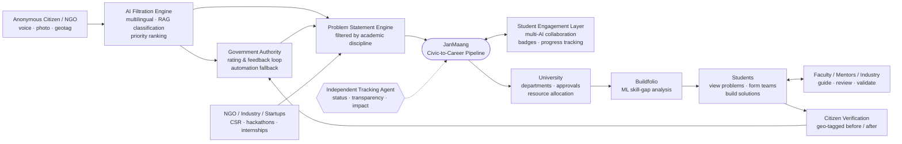

An **Independent Tracking Agent** monitors every problem statement from report to
resolution. It records status, keeps the process transparent, and captures impact.

### Stakeholder workflow

Who hands what to whom. The Gram Panchayat or department filters each report and decides
whether it goes out as a free or government-sponsored problem statement, or to industry for
sponsorship. Students reach problems through their institute, and citizens close the loop.

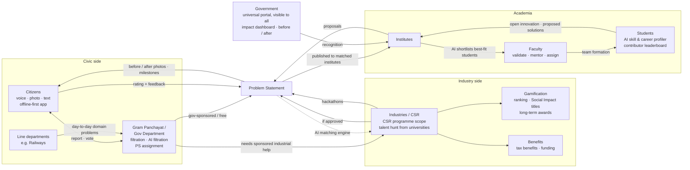

Students start with *good first issues*: small government problems that build trust, give a
performance record, and count as experience with government projects.

### Example: a department feeding the pipeline

Each officer gets a dashboard of day-to-day problems from their own domain. Using Indian
Railways as the example:

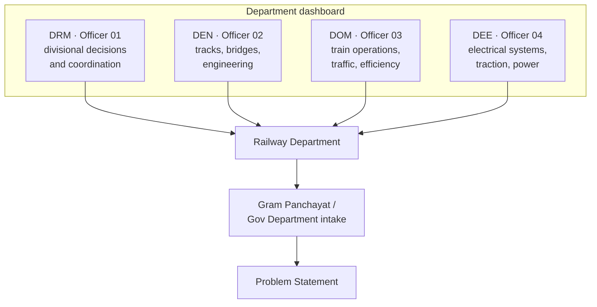

### From report to ranked demand

A report never waits on the model. The API stores it and answers straight away, and the
worker does the AI work in the background.

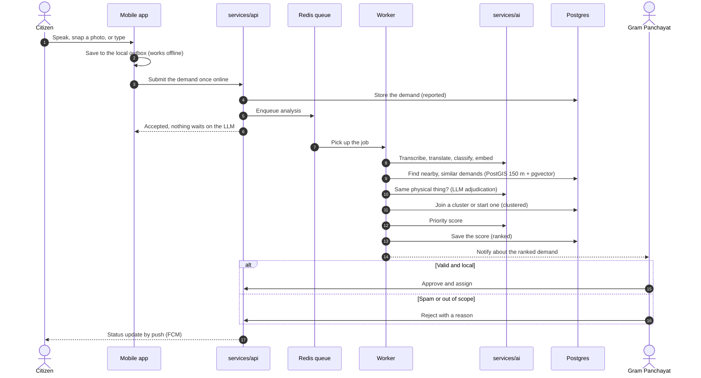

### From problem statement to verified fix

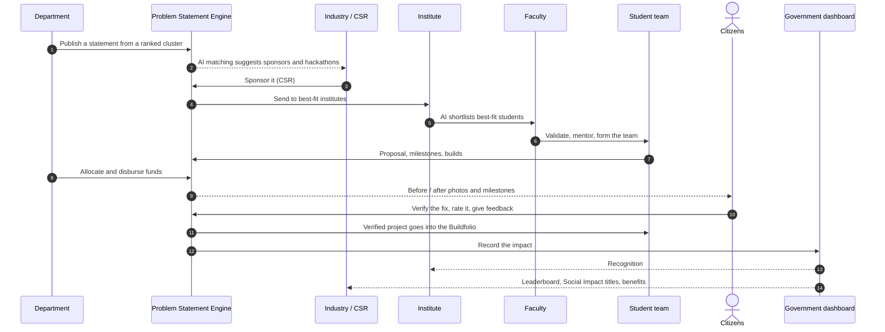

### Lifecycle vocabulary

Each term means one thing everywhere: in the database, the API, and all three codebases.
See [docs/product/glossary.md](docs/product/glossary.md).

> **Demand** → clustered into a **Cluster** → ranked by **Priority Score** → published as a
> **Problem Statement** → built by a **Project** → funded via **Allocation** →
> **Disbursement** → **Verification** → **Impact**

A problem moves through the statuses in `ProblemStatus`
([services/api/app/shared/enums.py](services/api/app/shared/enums.py)):

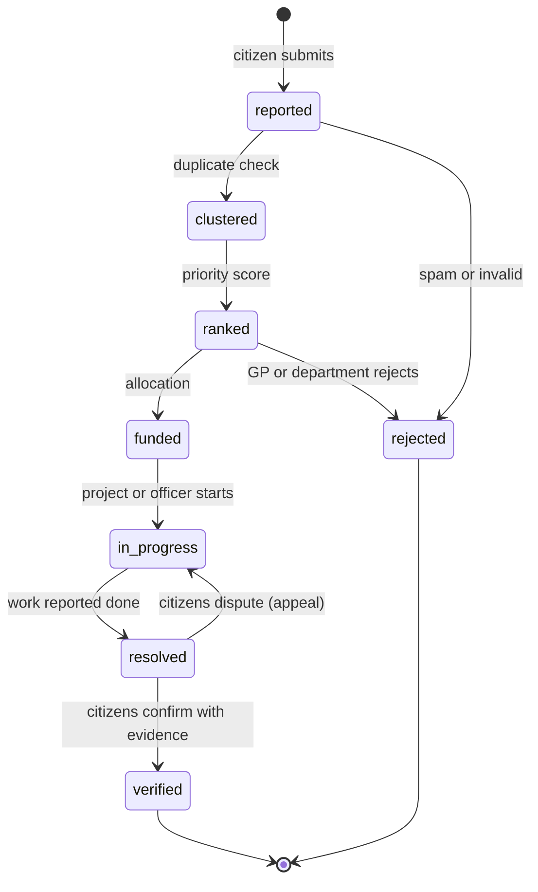

### Roles

| Role | Surface | In one line |
|---|---|---|
| Citizen | Mobile | Reports a need and verifies the fix |
| Student | Web | Forms teams and builds against problem statements |
| Faculty | Web | Mentors, reviews, endorses |
| Institute | Web | Manages students, faculty, and projects |
| Gram Panchayat | Web | Moderates and verifies local problems |
| Department | Web | Publishes statements and allocates funds |
| Officer | Web | Executes in the field and posts updates |
| Industry / CSR | Web | Sponsors work and reads impact |
| Government Admin | Web | State-wide oversight, funding, audit |
| Super Admin | Web | Platform configuration |

Endpoints require *permissions*, not roles, and scope (district, department, institute) is
checked separately. Full matrix: [docs/product/roles.md](docs/product/roles.md).

---

## Web Dashboards

One Next.js app serves every web role. After sign-in, the role proxy
([`apps/web/src/proxy.ts`](apps/web/src/proxy.ts)) sends each role to its own route segment,
and each segment has its own sidebar. Status and plan:
[docs/product/dashboards.md](docs/product/dashboards.md).

| Side | Route | Screens |
|---|---|---|
| **Student** | `/student` | Home · Problem Explorer · AI Project Council · Impact Hub · Industry Hub · Profile · Collaborate wizard |
| **Industry / CSR** | `/industry` | Home · Discover · Workspace · Labs · Monitoring · Impact · Project detail + proposal builder |
| **Government · Gram Panchayat** | `/panchayat` | Home · Demand Register · Verification Queue · Sanctioned Works |
| **Government · Department** | `/department` | District Command · Problem Reports · Docket · AI Clusters · Projects · Analytics |
| **Government · Officer** | `/officer` | Field Desk · Assigned Works · Work docket + field update · Site Visits |
| **Government · State Admin** | `/admin` | State Command · Districts · Funding & Sanctions · Audit Log · Users & Roles |

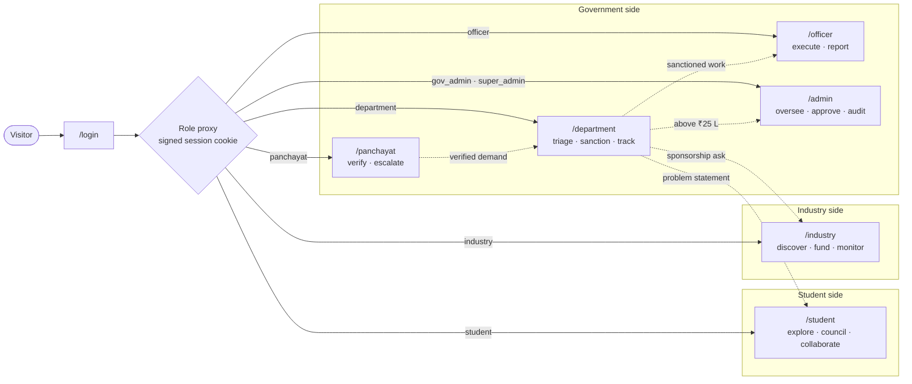

The proxy only shapes navigation. Every read and write is authorised again by the API.

### One work across every dashboard

The same record, W-2041 in the demo data, appears on every dashboard below. Each
dashboard can do only its own step to it.

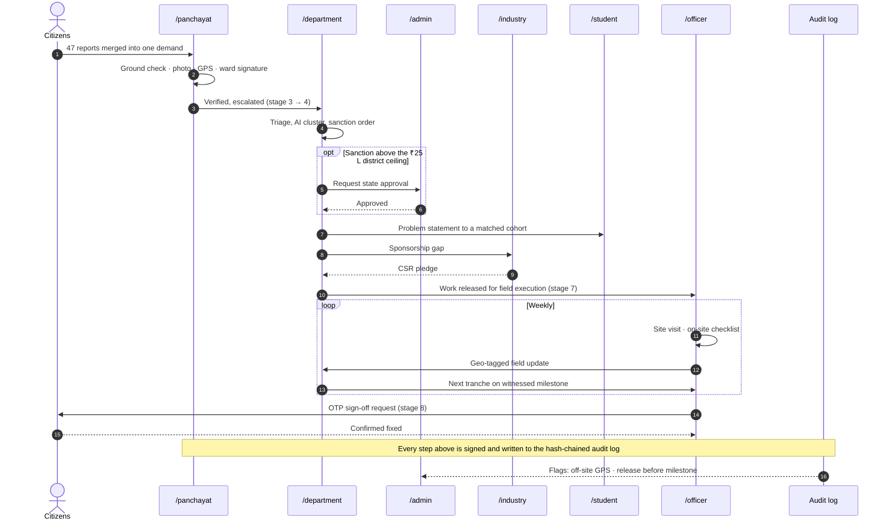

### Try it

Run `make dev`, open <http://localhost:3000/login>, and sign in as any persona. The
password for every persona is `janmaang`.

| Persona | Email | Lands on |
|---|---|---|
| Student | `aisha@student.janmaang.in` | `/student` |
| Industry / CSR | `csr@industry.janmaang.in` | `/industry` |
| Gram Panchayat | `sunita@panchayat.janmaang.in` | `/panchayat` |
| Department | `phed@dept.janmaang.in` | `/department` |
| Officer | `anand@officer.janmaang.in` | `/officer` |
| Government Admin | `meera@gov.janmaang.in` | `/admin` |
| Super Admin | `admin@janmaang.in` | `/admin`, and can switch into every view |

These personas come from [`apps/web/src/lib/auth/directory.ts`](apps/web/src/lib/auth/directory.ts),
a stand-in until the API's auth module lands. **Never deploy it anywhere reachable from
the internet.**

---

## Technical Approach

### Client layer

| Component | Stack |
|---|---|
| Citizen mobile app | Flutter + Riverpod 3 · Android / iOS + Flutter Web PWA · Drift (SQLite) local DB, WorkManager outbox |
| Web frontend | Next.js 16 (App Router) + TypeScript · public SEO/SSG portal + authenticated role dashboards |
| UI and components | Tailwind CSS v4 + shadcn/ui · Stitch design tokens · TanStack Table · Recharts |
| Client state and cache | TanStack Query (web) · Riverpod 3 (mobile) · polling, server cache, optimistic UI |
| Maps and GIS | Leaflet + flutter_map · OpenStreetMap + PMTiles offline packs · PostGIS LGD boundaries |

### API and services layer

| Component | Stack |
|---|---|
| Backend services | FastAPI modular monolith · single deployable · async Python 3.12, SQLAlchemy 2, Alembic |
| Background jobs | ARQ worker: the same image as the API, run with a different command |
| Service communication | In-process domain event bus that decouples modules without distributed microservices |
| API gateway and contracts | FastAPI OpenAPI + Pydantic v2 · Swagger docs · OpenAPI diff and TypeScript/Dart client generation in CI |

### Data layer

| Component | Stack |
|---|---|
| Primary database | PostgreSQL 16 + PostGIS · LGD administrative boundary polygons, jurisdiction tree paths, hash-chained audit events table |
| Cache and broker | Redis (Memorystore) · response cache, queue broker, rate limits, RBAC permission cache |
| Object storage | Cloudflare R2 (S3 API) · zero egress, presigned direct PUT/GET, MinIO-compatible |
| Search | PostgreSQL `pg_trgm` + full-text search + Reciprocal Rank Fusion |
| Vector database | pgvector (HNSW index) in the same PostgreSQL instance, so spatial and vector filters run in one query |

### AI / ML layer

| Component | Stack |
|---|---|
| AI client and gateway | Custom `LLMClient` (~150 LOC): one abstraction over Vertex AI, Gemini, and OpenAI-compatible providers |
| Foundation LLM | Gemini 2.5 Flash (Vertex AI, `asia-south1`) · multilingual classification, few-shot statement drafting, duplicate adjudication |
| Embeddings | BAAI models via Sentence Transformers · local semantic vectors for Indic languages and similarity tasks |
| Deduplication cascade | PostGIS 150 m radius → pgvector cosine → LLM adjudication: deterministic spatial and semantic filtering before the model is called |
| Speech-to-text | ElevenLabs · Hindi, Santali, Ho, Kurukh, Mundari, and more |
| Translation | ElevenLabs · low-resource Indic language translation |
| Computer vision and verification | plash + OpenCV + Gemini Vision · capture-time attestation, tamper checks, before/after scene comparison |
| Geo-verification | PostGIS `ST_Contains` + geofence · point-in-polygon, GP routing, distance constraints on evidence |
| Scoring engine | scikit-learn + published formula weights for a transparent, explainable priority score |
| AI observability | `ai_runs` table in PostgreSQL · prompt versions, token cost, latency, confidence score |

The AI service ([`services/ai`](services/ai)) is organised by capability: `classification`,
`deduplication`, `prioritization`, `statement_generation`, `matching`, `recommendation`,
`speech`, `language`, `vision`, and `chat`.

Duplicate detection runs as a cascade, cheapest check first, so the LLM only sees the few
pairs that survive the spatial and vector filters:

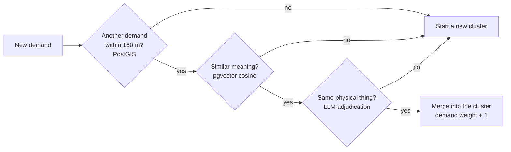

### Security and infrastructure layer

| Component | Stack |
|---|---|
| Authentication | FastAPI JWT + Firebase Phone Auth (OTP) · refresh tokens, 2FA, secure sessions |
| Authorization | RBAC in PostgreSQL · single authority, hierarchical roles, fine-grained permissions |
| Secrets | GCP Secret Manager / `.env` · injected at runtime, scanned by gitleaks in pre-commit and CI |
| Containerization | Docker (OCI) · multi-stage Dockerfiles for the API, the worker, and standalone Next.js |
| Orchestration | Google Cloud Run · scale-to-zero serverless containers · Kustomize manifests ready for Kubernetes ([infrastructure/kubernetes](infrastructure/kubernetes/README.md)) |
| CI/CD | GitHub Actions · path-filtered CI per service, images pushed to GHCR, auto-deploy to staging, approval-gated promotion to production, smoke test + rollback · Dependabot |

---

## Architecture

### System architecture

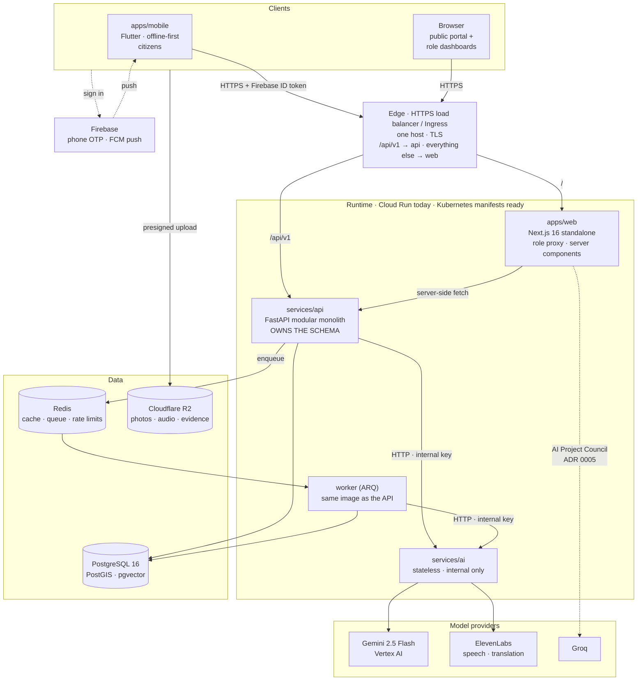

The line from the web app to Groq is the one documented exception to Invariant 3: the AI
Project Council still runs in the web app's server routes.

### Inside the API

One deployable, split into modules that only talk through each other's `service.py` and
`schemas.py`, plus an in-process event bus.

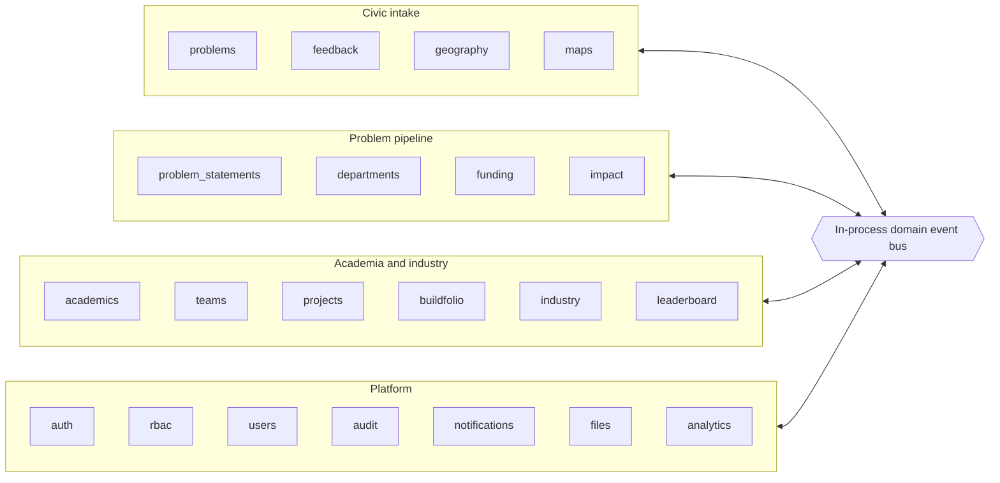

### Invariants

1. **The API owns the schema.** Nothing else writes DDL. The AI service is stateless.
2. **Modules talk through `service.py` and `schemas.py` only**, enforced by `import-linter` in CI.
3. **The AI service is internal.** The API is its only caller ([one documented exception](docs/architecture/decisions/0005-council-in-the-web-app.md)).
4. **Authorisation is server-side.** Client-side role checks are UX only.
5. **Types flow one way:** FastAPI → OpenAPI → TypeScript client and Dart models.
6. **No client ships a server-side credential.**
7. **Slow work is queued.** Nothing a citizen waits on blocks on an LLM.

### Architecture decisions

| ADR | Decision |
|---|---|
| [0001](docs/architecture/decisions/0001-one-repository.md) | One repository, polyglot, no cross-ecosystem monorepo tool |
| [0002](docs/architecture/decisions/0002-postgres-over-firestore.md) | Postgres + PostGIS primary; Firebase kept for Auth and FCM |
| [0003](docs/architecture/decisions/0003-separate-ai-service.md) | One separate AI service, modular by capability, stateless |
| [0004](docs/architecture/decisions/0004-single-web-app.md) | One web app with role-based routes |
| [0005](docs/architecture/decisions/0005-council-in-the-web-app.md) | The AI Project Council runs in the web app (accepted debt) |

See [ARCHITECTURE.md](ARCHITECTURE.md) for how modules can be extracted later without a rewrite.

---

## Deployment

Three images (`web`, `api`, `ai`; the worker reuses `api`) are built once per commit and
promoted, never rebuilt. Production runs the exact image staging tested.

```mermaid
flowchart LR
    PR["Pull request"] --> CI
    subgraph CI["CI · path-filtered per service"]
        direction TB
        CW["ci-web<br/>lint · typecheck · test · build"]
        CA["ci-api · ci-ai<br/>ruff · mypy · pytest"]
        CM["ci-mobile · ci-contracts · e2e<br/>flutter test · OpenAPI diff · Playwright"]
        CS["security<br/>gitleaks · CodeQL · audit"]
    end
    CI -->|"squash-merge to main"| IMG["Build images<br/>web · api · ai"]
    IMG --> REG[("GHCR<br/>:sha · :staging")]
    REG --> STG["Staging<br/>auto-deploy"]
    STG --> SM1{"Smoke test<br/>api + web"}
    SM1 -->|"pass"| GATE{{"Manual approval<br/>production environment"}}
    GATE --> TAG["Retag :sha → :production<br/>no rebuild"]
    TAG --> BK["Back up database"] --> MIG["alembic upgrade head"] --> ROLL["Roll services"]
    ROLL --> SM2{"Smoke test"}
    SM2 -->|"fail"| RB["rollback.sh"]
    SM2 -->|"pass"| LIVE(["Live"])
```

At runtime, one public host fronts everything. The AI service has no route from outside.

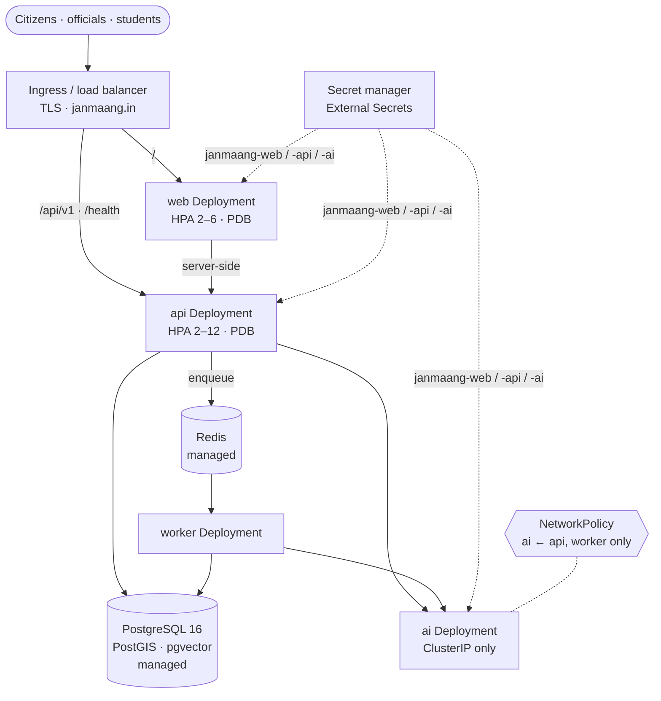

Every pod runs as a non-root user with a read-only root filesystem, and both
namespaces enforce the `restricted` Pod Security Standard. See
[docs/deployment/environments.md](docs/deployment/environments.md) and
[infrastructure/kubernetes/README.md](infrastructure/kubernetes/README.md).

---

## Repository Layout

```
.github/
  workflows/       ci-web · ci-api · ci-ai · ci-mobile · ci-contracts · e2e · security
                   · ai-evals · deploy-staging · deploy-production
  actions/         shared composite actions (Python service setup)
  ISSUE_TEMPLATE/  bug · feature · task
  CODEOWNERS · dependabot.yml · pull_request_template.md
apps/
  mobile/          Flutter citizen app (offline-first)
  web/             Next.js: public portal + role dashboards in one app
    src/app/(app)/   student · industry · panchayat · department · officer · admin · …
    src/features/    screen data and components, one folder per backend module
services/
  api/             FastAPI modular monolith. Owns the schema.
                   modules: problems, problem_statements, projects, teams,
                   buildfolio, academics, industry, funding, impact,
                   leaderboard, maps, geography, rbac, audit, ...
  ai/              Internal AI service, modular by capability. Stateless.
packages/
  contracts/       Generated API contract → TypeScript client + Dart models
  tokens/          Design tokens → CSS variables + Dart constants
  ui/              React primitives (web only)
  config/          Shared lint / TS / Prettier presets
infrastructure/
  docker/          Postgres + PostGIS + pgvector image
  kubernetes/      Kustomize base + staging / production overlays
  terraform/       Planned; filled in at the first cloud deployment
  scripts/         backup · restore · rollback · smoke-test
docs/              Architecture, ADRs, database, AI, deployment, product
scripts/           setup · doctor · contract generation
tests/e2e/         Cross-service journeys
```

Flutter uses pub, TypeScript uses pnpm workspaces, and Python uses uv. `make` wraps all
three, so there is one command interface to learn.

---

## Getting Started

### Prerequisites

- Docker + Docker Compose
- Node.js ≥ 20.11 and pnpm 9
- Python 3.12 and [uv](https://github.com/astral-sh/uv)
- Flutter SDK (for the citizen app)

`make doctor` checks versions, ports, containers, and the database.

### Run it locally

```bash
git clone https://github.com/rokadepiyush49-rgb/JanMaang.git janmaang
cd janmaang
make setup     # tools, .env files, dependencies, database, seed data
make dev       # postgres, redis, api, worker, ai, web
```

| Service | URL |
|---|---|
| Web | <http://localhost:3000> |
| API docs (Swagger) | <http://localhost:8000/docs> |
| AI service docs | <http://localhost:8001/docs> |
| Citizen app | `make mobile` (or `make mobile-ios`) |

Each service has its own `.env`. The root `.env` holds infrastructure values only, so the
web app can never be handed the LLM key. Full guide:
[docs/development/setup.md](docs/development/setup.md).

### Common commands

| Command | Does |
|---|---|
| `make help` | List every target |
| `make dev` / `make down` | Start / stop the stack (data volumes survive) |
| `make logs s=api` | Tail one service's logs |
| `make migrate` | Apply pending migrations |
| `make migration name="..."` | Create a migration |
| `make seed` | Load reference + demo data |
| `make reset-db` | Drop, recreate, migrate, reseed (destroys local data) |
| `make contracts` | Regenerate OpenAPI + TypeScript client + Dart models |
| `make check` | Lint, typecheck, and test every ecosystem (what CI runs) |
| `make test-api` · `test-ai` · `test-web` · `test-mobile` | Per-ecosystem tests |
| `make evals` | AI quality evals against golden datasets (makes real LLM calls and costs money) |

---

## Data Transparency

[`docs/SOURCES.md`](docs/SOURCES.md) is the source of truth for data provenance. The app
renders it at `/method`: every dataset, its licence, what it feeds, and what was rejected
and why. Every seeded record is labelled (for example, *"Synthetic rural · Approximate
location"*).

No SLA or time-to-resolution metric appears anywhere. The public grievance datasets have
no closure timestamp, so that number can't be computed and would have to be invented.

On the map, issues are aggregated by location and ranked across four density tiers. Pin
size, ring weight, and the count badge change with the tier, so colour is never the only
signal.

---

## Feasibility and Viability

### Feasibility

- **Technology ready:** AI/ML, multilingual NLP, speech-to-text, GIS, cloud, and mobile technologies are mature and deployable.
- **Existing digital infrastructure:** 24,709 functional Common Service Centres with 100% Gram Panchayat coverage provide last-mile access for citizens.
- **Modular architecture:** citizen reporting, AI filtration, matching, Buildfolio, and government monitoring are independent modules that can be shipped progressively.
- **Scalable deployment:** pilot → district → statewide, on cloud-native infrastructure.

### Viability

- **Large addressable ecosystem:** 4,347 Gram Panchayats and 32,620 villages in Jharkhand produce a steady pipeline of local challenges.
- **Multi-stakeholder value:** citizens, government, universities, students, startups, MSMEs, and industry each benefit directly.
- **Sustainable revenue:** government deployments, CSR-sponsored challenges, industry projects, institutional partnerships, and premium innovation services.
- **Civic-to-career value:** verified problems become student projects, internships, research collaborations, and industry opportunities.

### Supporting facts (Jharkhand)

- 4,343 of 4,347 Gram Panchayats uploaded GP Development Plans for 2025–26, giving a base for structured local problem identification.
- 24,709 functional Common Service Centres with 100% Gram Panchayat coverage.
- ₹275.12 crore released to Jharkhand's Panchayati Raj institutions in FY 2025–26, benefiting 4,342 Gram Panchayats.

### Challenges and mitigation

| Challenge | Mitigation |
|---|---|
| False and duplicate reporting | AI validation + duplicate detection using similarity and location signals |
| False resolution claims | Evidence-based closure with geo-tagged before/after proof |
| Digital and language barriers | Multilingual + voice + offline-first interaction |
| AI accuracy and bias | Human-in-the-loop validation, confidence scores, feedback-based correction |
| Stakeholder adoption | Incentives, internships, and measurable outcomes |
| Data privacy and security | Role-based access, encryption, prompt-injection safeguards |

---

## Impact

| Audience | Benefit |
|---|---|
| **Citizens** | Multilingual, voice-based, offline-first access sends local issues to the right stakeholders for faster resolution. |
| **Students** | More access to real-world projects, internships, and industry collaboration. |
| **Universities** | Mentorship, sponsored projects, internships, and collaborative R&D. |
| **Industry** | Faster discovery of verified civic and industrial problems that match their expertise. |
| **Government** | Impact dashboards showing problem status, resolution, beneficiaries, and outcomes. |

- **Social:** citizen empowerment, inclusive participation, transparent governance.
- **Economic:** student employability, local economic development, CSR and innovation funding.
- **Educational:** ML-driven skill growth, a continuous problem pipeline for institutions, experiential learning.
- **Technological:** automated civic intelligence, voice-first accessibility, multi-agent AI support for student teams.

---

## Comparison

| Feature | JanMaang | YIP-Kerala | CPGRAMS | MyGov Jharkhand |
|---|:---:|:---:|:---:|:---:|
| Citizen grievance submission | ✅ | ❌ | ✅ | ✅ |
| AI-based auto-classification | ✅ | ❌ | ✅ | ❌ |
| Multilingual (regional dialects) | ✅ | ❌ | ✅ | ✅ |
| Routing to universities by expertise | ✅ | ✅ | ❌ | ❌ |
| University–industry collaboration | ✅ | ✅ | ❌ | ❌ |
| Gamification (badges / leaderboard) | ✅ | ❌ | ❌ | ❌ |
| Skill-gap analysis (ML) | ✅ | ❌ | ❌ | ❌ |
| Post-resolution outcome tracking | ✅ | ✅ | ❌ | ❌ |
| Real-time analytics dashboard | ✅ | ❌ | ✅ | ❌ |
| Anonymous submission | ✅ | ❌ | ❌ | ❌ |
| Appeal / feedback mechanism | ✅ | ❌ | ✅ | ❌ |

---

## Research and References

### Research papers

- *Research on triple helix of university–industry–government relations: Empirical evidence from China*, IEEE ICMSE 2014
- *Autonomous Grievance Redressal System for Government Services*, ICDSBS, IEEE 2025
- *AI-enhanced competency transfer hubs: a conceptual framework for university–industry engagement and knowledge sharing*, The Journal of Technology Transfer, Springer 2026

### Existing platforms

- [Young Innovators Programme, Kerala](https://yip.kerala.gov.in/theme)
- [CPGRAMS: Centralised Public Grievance Redress and Monitoring System](https://pgportal.gov.in/)
- [MyGov Jharkhand](https://jharkhand.mygov.in/en)
- [Unnat Bharat Abhiyan](https://unnatbharatabhiyan.gov.in/)

### Feasibility data

- NITI Aayog, *State Summary Report: Jharkhand* (2025)

---

## Documentation

| | |
|---|---|
| [ARCHITECTURE.md](ARCHITECTURE.md) | System shape, invariants, extraction plan |
| [apps/mobile](apps/mobile/README.md) | Citizen app: running it, mocks, brand assets |
| [docs/development/setup.md](docs/development/setup.md) | Full local setup |
| [docs/development/workflow.md](docs/development/workflow.md) | Branching and PR rules |
| [docs/development/testing.md](docs/development/testing.md) | Test strategy |
| [docs/ai/evaluation.md](docs/ai/evaluation.md) | AI evals and golden datasets |
| [docs/deployment/runbook.md](docs/deployment/runbook.md) | Deployment runbook |
| [docs/product/roles.md](docs/product/roles.md) | Roles and permission matrix |
| [docs/product/dashboards.md](docs/product/dashboards.md) | Every role dashboard: what is built, what is planned |
| [docs/deployment/environments.md](docs/deployment/environments.md) | Staging vs production, smoke tests, rollback |
| [infrastructure/kubernetes](infrastructure/kubernetes/README.md) | Kustomize manifests and what the cluster must provide |
| [docs/product/glossary.md](docs/product/glossary.md) | Demand vs Cluster vs Problem Statement vs Project |
| [docs/STITCH_INVENTORY.md](docs/STITCH_INVENTORY.md) | Screen-by-screen design mapping and token table |
| [docs/SOURCES.md](docs/SOURCES.md) | Data provenance (rendered in-app at `/method`) |

## Contributing

Read [CONTRIBUTING.md](CONTRIBUTING.md). The short version: branch from `main`, keep
branches under two days and 400 lines, run `make check`, and open a PR.

## Security

No server-side credential ships in any client. The LLM key lives only in the AI service,
which only the API can reach. Ranking, clustering, funding, and verification are
server-write-only. Report vulnerabilities as described in [SECURITY.md](SECURITY.md).

## Team

Built by **Team Admiral** for **Smart India Hackathon 2026**.

## License

[MIT](LICENSE) © 2026 JanMaang
