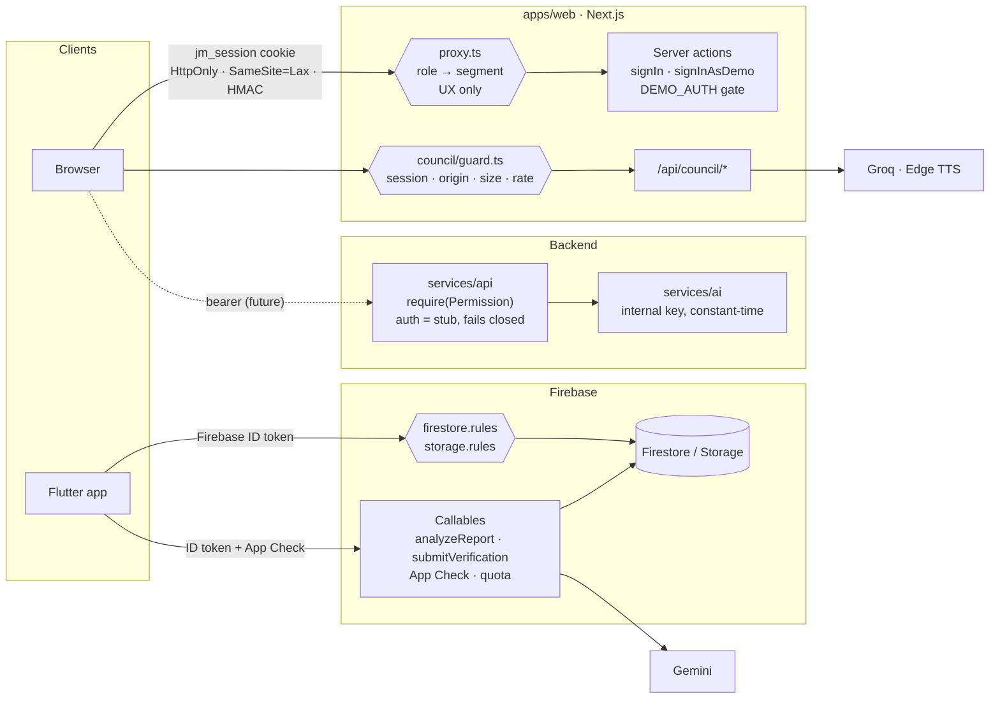

# Security audit

**Scope:** the whole monorepo at branch `security/production-hardening`
(based on `feat/gov-dashboards`): `apps/web`, `apps/mobile` (Flutter +
`firebase/` rules and Cloud Functions), `services/api`, `services/ai`, CI/CD,
Docker and Kubernetes.
**Date:** 2026-10-25. **Method:** read the code, ran every available test and
scanner, then probed a locally built production server. References: OWASP
Top 10 (2021), OWASP API Security Top 10 (2023), OWASP MASVS.

No secret values appear in this report. No `.env` file has ever been committed
on any branch (`git log --all` checked), and no key, token or private-key
pattern exists in tracked files.

## What actually runs

The security posture depends on which parts are real, so this comes first.

| Component | State | Live attack surface today |
|---|---|---|
| `apps/web` (Next.js 16) | Built: 9 role segments, demo sign-in, AI Council | Login, session cookie, role proxy, 3 AI routes, `/api/health` |
| `services/api` (FastAPI) | **Skeleton.** 21 modules, **0 routes**, no migrations, auth stub | `/health`, `/api/v1/openapi.json` only |
| `services/ai` (FastAPI) | **Skeleton.** 10 capabilities, **0 routes** | `/health`; everything else behind the internal key |
| `apps/mobile` (Flutter) | Built UI running on **mocks**; Firebase not initialised | None until Firebase is wired |
| `apps/mobile/firebase` | Rules + 4 Cloud Functions written | Becomes the citizen data plane the day the app is wired |

## Security architecture

Trust boundaries: the browser and the phone are untrusted. The role proxy is
navigation only; **authorisation lives in** the council guard, the server
actions, the Firebase rules, the callables, and (once it exists) the API's
`require(Permission)`.

## Permission matrix

Web segments (`apps/web/src/lib/auth/roles.ts`, enforced by `proxy.ts` and by
the session check in every `(app)` layout):

| Segment | citizen | student | faculty | institute | panchayat | department | officer | industry | gov_admin | super_admin |
|---|---|---|---|---|---|---|---|---|---|---|
| `/student` + `/api/council/*` | | ✓ | | | | | | | | ✓ |
| `/faculty` | | | ✓ | ✓ | | | | | | ✓ |
| `/institute` | | | | ✓ | | | | | | ✓ |
| `/panchayat` | | | | | ✓ | | | | ✓ | ✓ |
| `/department` | | | | | | ✓ | | | ✓ | ✓ |
| `/officer` | | | | | | ✓ | ✓ | | | ✓ |
| `/industry` | | | | | | | | ✓ | | ✓ |
| `/admin` | | | | | | | | | ✓ | ✓ |

API permissions: `services/api/app/core/permissions.py` (`ROLE_PERMISSIONS`),
rendered at `/admin/users`; `apps/web/src/features/gov/admin.test.ts` fails if
the web copy drifts. Firebase: any signed-in user is a citizen; `officer`
is a custom claim only the server can set.

## Findings

Severity is impact × exploitability for this codebase. Status: **Fixed** =
code changed and the stated verification passed; **Fixed, unverified** = code
changed, verification could not run here (see SECURITY_TEST_PLAN.md);
**Open** = documented, not fixed.

| ID | Sev | Finding | Component | Status |
|---|---|---|---|---|
| S-01 | Critical | Passwordless "demo" sign-in for every role, Super Admin included, active in production builds; one shared password published in the README | web auth | Fixed |
| S-02 | Critical | `next@16.3.4`: two unauthenticated RCE advisories (Image Optimization API, `use cache`), plus SSRF and a Server Actions DoS | web deps | Fixed |
| S-03 | Critical | `submitVerification`: any signed-in account could close or reopen any in-progress demand; `kind: 'field'` never checked the officer claim | Cloud Functions | Fixed, partly verified |
| S-04 | High | Storage: any signed-in user could overwrite or delete anyone's verification photo; `image/svg+xml` accepted and served publicly | storage.rules | Fixed; emulator tests in CI (isolated re-run pending) |
| S-05 | High | `/api/council/{turn,verdict,speech}` open to the internet: spends the Groq key, free TTS proxy | web API | Fixed |
| S-06 | High | Open redirects: proxy accepted `?next=//evil`, login action accepted `?next=/\evil` | web auth | Fixed |
| S-07 | High | Firestore: demand creation could set `supporterCount`, `scoreBreakdown`, `totalRanked`, `code`; reporter could rewrite `reporterId`; supporters on non-existent demands | firestore.rules | Fixed; emulator tests in CI (isolated re-run pending) |
| S-08 | High | Placeholder secrets from `.env.example` accepted in production (web `AUTH_SECRET`, API `AUTH_SECRET`/`AI_SERVICE_KEY`, AI `INTERNAL_API_KEY`) → forgeable sessions | web, api, ai config | Fixed |
| S-09 | High | `pyjwt` 2.13 (12 advisories; it verifies every future API token), `urllib3`, `certifi`, `opentelemetry-api` | api, ai deps | Fixed |
| S-10 | High | Unused runtime deps with advisories shipped: `maplibre-gl` (critical XSS), `firebase` (grpc), `zod` | web deps | Fixed (removed) |
| S-11 | High | CI dependency audit only warned, so S-02/S-09 sat green | CI | Fixed |
| S-12 | High | Web Docker image built from repo root copied all `.env` files into layers (local builds) | Docker | Fixed in PR #2 |
| S-13 | Medium | Demo directory (emails, password) bundled into client JS | web | Fixed |
| S-14 | Medium | No CSP / security headers on web; `X-Powered-By` disclosed | web | Fixed |
| S-15 | Medium | API: no security headers, no body limit, credentialed CORS with `*` methods/headers, `CORS_ORIGINS=*` accepted, crash response shape left to defaults | api | Fixed |
| S-16 | Medium | API crashed at startup on the documented `CORS_ORIGINS=http://…` (pydantic-settings JSON-decoded it) | api config | Fixed |
| S-17 | Medium | AI internal key compared with `!=` (timing) | ai | Fixed |
| S-18 | Medium | `analyzeReport`: no per-user quota; model free text unbounded | Cloud Functions | Fixed, unverified (quota) |
| S-19 | Medium | Council routes returned raw upstream error messages | web API | Fixed |
| S-20 | Medium | Functions `package.json` uninstallable (`eslint ^9.40.0`), no lockfile, 9 advisories | Cloud Functions | Fixed |
| S-21 | Medium | Mobile: app-data backup allowed; release builds log stack traces | mobile | Fixed |
| S-22 | Medium | Sessions are stateless HMAC cookies: sign-out does not revoke a stolen cookie (valid ≤ 8 h) | web auth | Open |
| S-23 | Medium | No login rate limit or lockout (only demo auth exists) | web auth | Open, blocked on real auth |
| S-24 | Medium | API has no authentication, schema or endpoints; production cannot authenticate anyone | api | Open (P0 roadmap) |
| S-25 | Low | Demands are world-readable including `reporterId` (pseudonymous linkage), against the "anonymous citizen" promise | firestore.rules | Open, design decision |
| S-26 | Low | Android release builds signed with the debug key | mobile | Open, manual |
| S-27 | Low | CSP keeps `'unsafe-inline'` for scripts (no nonces) | web | Accepted trade-off |
| S-28 | Low | Council rate limit is per server instance | web | Accepted until scale-out |
| S-29 | Low | Dev tooling `vitest@2`/`vite@5` critical advisories (dev only) | web dev deps | Fixed |
| S-30 | Info | Edge TTS uses a public client token (allow-listed in `.gitleaks.toml`); reliability/ToS risk, not a secret | web | Open |

## Detail on the critical findings

**S-01.** `signInAsDemo` is a server action — a public POST endpoint whether or
not the button renders. It issued a session for any role on request, and
`authenticate()` accepted `janmaang` for every persona. In a production build
anyone could become Super Admin. *Fix:* `demoAuthEnabled()` returns false in
production builds unless `DEMO_AUTH=enabled`; both actions and the login page
check it server-side; `directory.ts` is `server-only`. *Verified:* unit tests
(`directory.test.ts`) and a `next start` production probe — no demo section or
demo emails in the HTML.

**S-02.** Upgraded to `next@16.4.2`. `pnpm audit --prod` and full `pnpm audit`
report no known vulnerabilities; lint, typecheck, 76 tests and `next build`
pass.

**S-03.** The verdict now requires: reporter or supporter for `citizen`;
`officer` claim for `field`; one verdict per person per demand per kind;
validated checklist and Storage-only HTTPS photo URLs; all inside one Firestore
transaction. *Verified:* `tsc` clean; 8 input-validation tests pass. The
transactional authorisation path needs the emulator, which needs Java; that
test runs in the new `ci-firebase.yml`.

## Out of scope / not assessed

Live infrastructure (none deployed), DNS/TLS, the Firebase project's console
settings, App Check provider setup, and penetration testing of third-party
providers.
